# LOTUS – Meditation & Breath

**Eine ruhige Android-App für Einschlafgeschichten, Atemübungen und Klänge.**
Konzept, UX/UI-Design, Prototyp und Inhalte: **Maria Springer**

▶ **Live-Prototyp:** https://maringerms-hue.github.io/lotus-app/
(am besten auf dem Smartphone öffnen oder im Browser die Handy-Ansicht wählen)

<p>
  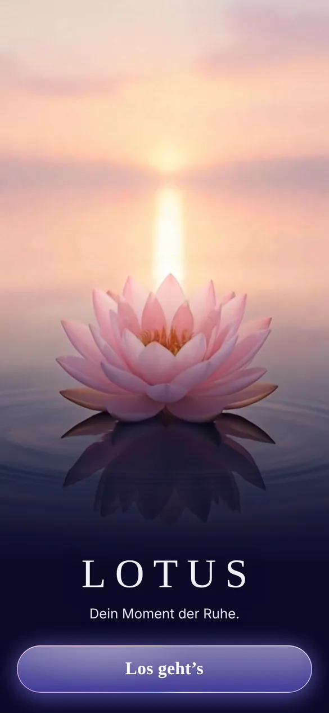
  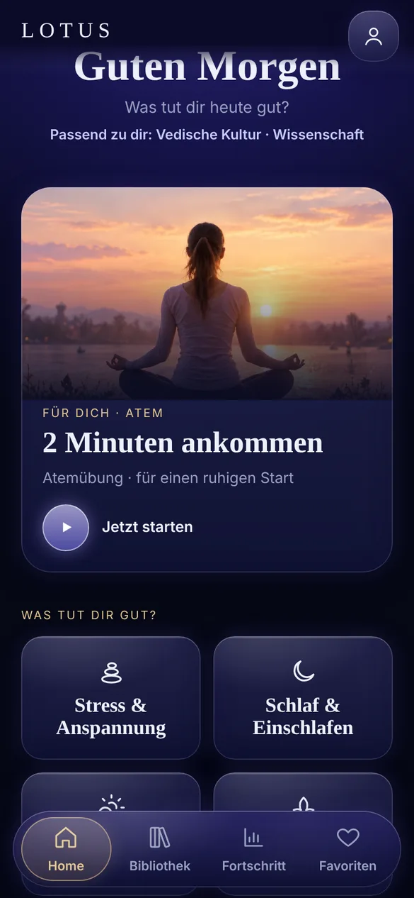
  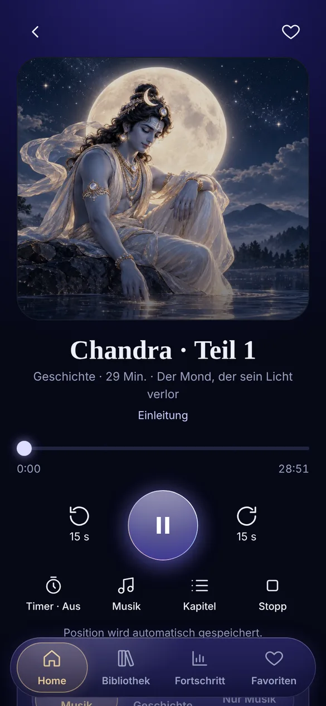
  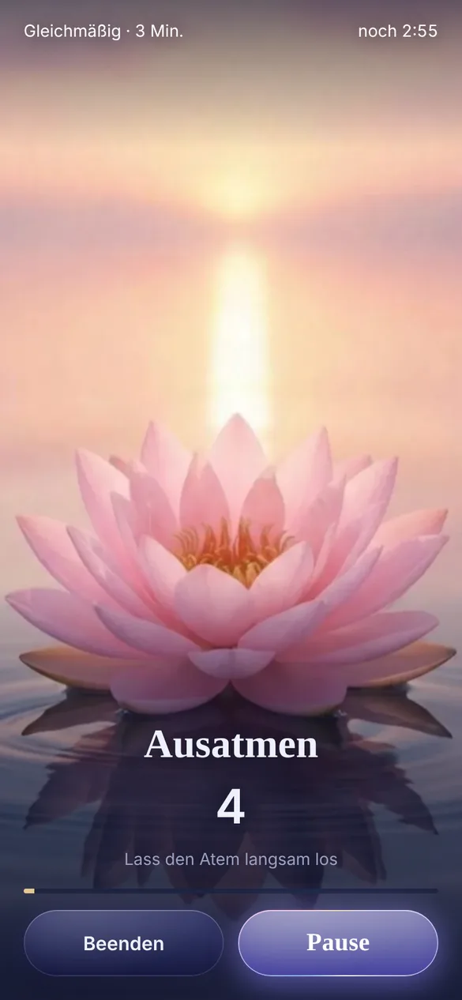
</p>

---

## Worum es geht

LOTUS hilft dabei, abends zur Ruhe zu kommen und tagsüber kurz durchzuatmen – mit
sanft erzählten Geschichten aus Mythologie, Philosophie und Wissenschaft, geführten
Atemübungen und ruhiger Musik.

Die App ist bewusst als **Wellness-App** angelegt: keine Diagnosen, keine Tests,
keine Heilversprechen.

## Meine Rolle

Ich habe LOTUS von der Idee bis zum Prototyp allein umgesetzt:

- **UX:** Zielgruppe, Nutzerfluss, Informationsarchitektur, Onboarding mit Interessen
- **UI:** Design-System in Figma (Farb-, Radius- und Abstands-Tokens, Glas-Komponenten)
- **Inhalte:** Texte der Geschichten, Zitatsammlung mit geprüften Quellen, eigene Fotos
- **Motion:** Lotus-Animation (Blender, Kling), scrollgesteuertes Intro
- **Audio:** Vertonung und Musik mit ElevenLabs
- **Prototyp:** HTML, CSS und JavaScript, umgesetzt mit Unterstützung von Claude (KI)

## Status

🟡 **In Entwicklung.** Dieses Repository dokumentiert den aktuellen Stand:

- ✅ UX-Konzept, Nutzerfluss und Informationsarchitektur
- ✅ Design-System in Figma (Farb- und Radius-Tokens, Glas-Komponenten, Gold-Akzent)
- ✅ Klickbarer Web-Prototyp mit echten Inhalten (Audio, Bilder, Texte)
- 🔜 Native Android-App (Kotlin, Jetpack Compose) – Ordner `android/` folgt
- 🔜 Weitere Geschichten und Klänge, danach Veröffentlichung im Google Play Store

## Was der Prototyp zeigt

| Bereich | Inhalt |
|---|---|
| **Onboarding** | Willkommen mit animiertem Lotus, 3 Fragen (Ziele, Themen, Angebote), Personalisierung |
| **Home** | Scroll-Intro mit sich öffnendem Lotus, Empfehlung, „Was tut dir gut?“, Weiterhören, „Passend zu dir“, Gedanke des Tages |
| **Bibliothek** | Suche, Filter, Themen-Leisten, „Bald verfügbar“-Inhalte, Free/Premium-Kennzeichnung |
| **Player** | Hörbuch-Player mit Kapiteln, ±15 s, Timer, Musik-Mix, Hörposition wird gespeichert |
| **Atemübungen** | Gleichmäßig, Länger ausatmen, Seufzer-Atmung, Box Breathing, Bhramari, Wechselatmung |
| **Fortschritt** | Optionale Kurz-Checks vor/nach der Übung, Morgen-Check nach Einschlafgeschichten |
| **Profil** | Hörzeit, Favoriten, Interessen, Konto, Einstellungen, Daten löschen |
| **Konto & Abo** | Gast-Modus, Google-Anmeldung und Google-Play-Abo als **Demo** (simuliert) |
| **Gedanken** | Zitatsammlung (Yogananda, Seneca, Einstein …) mit Quellenangaben |

<p>
  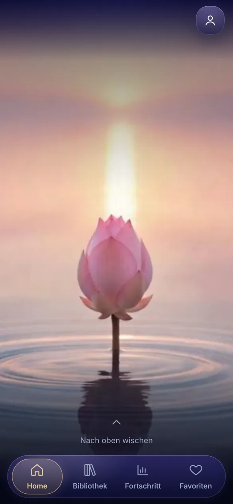
  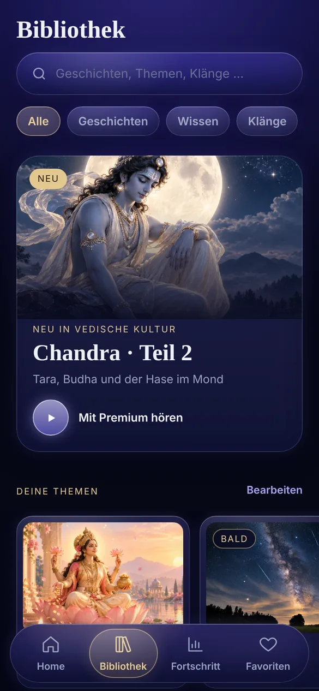
  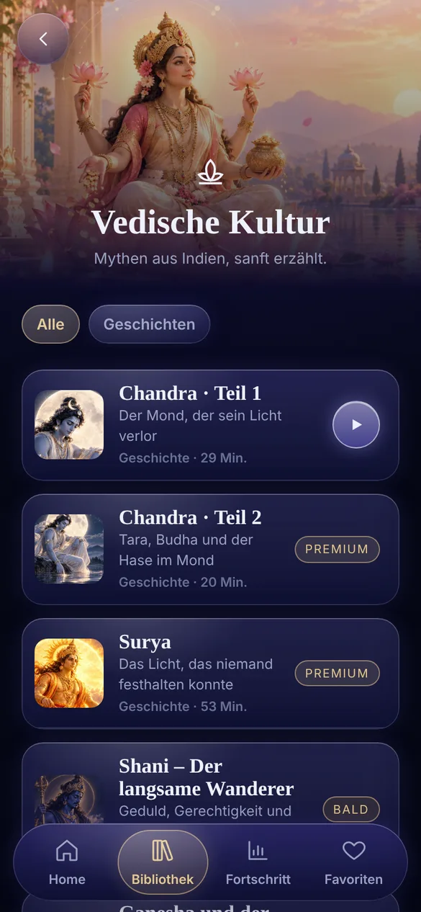
  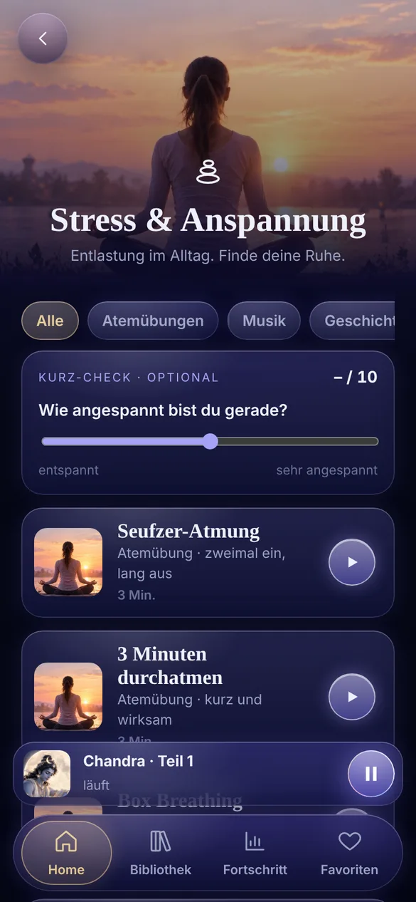
  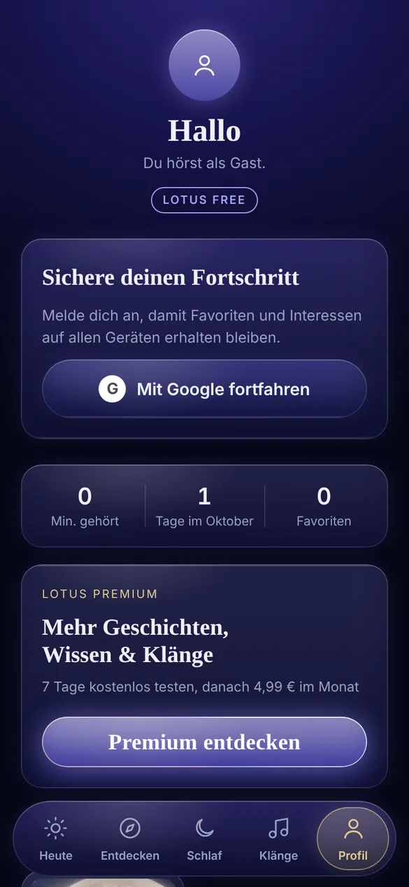
  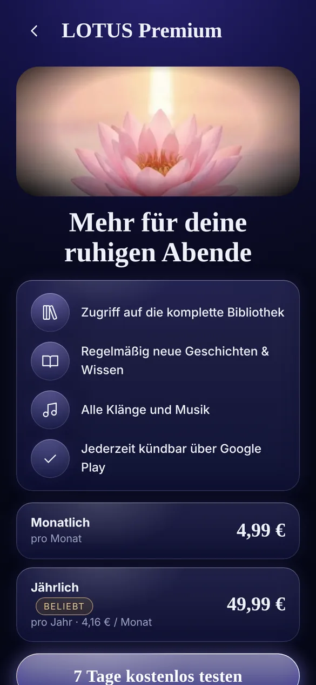
  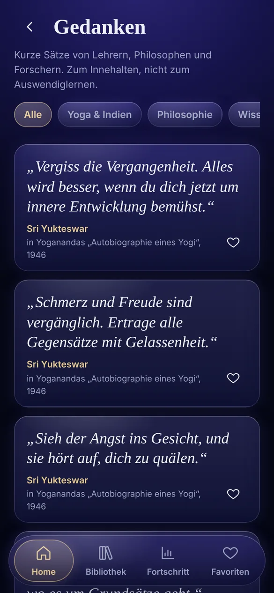
</p>

## Geschäftsmodell (geplant)

- **Kostenlos:** Gast-Zugang ohne Konto, ausgewählte Geschichten, Atemübungen, Naturklänge
- **LOTUS Premium:** 4,99 € / Monat oder 49,99 € / Jahr, 7 Tage kostenlos testen
- Abrechnung über Google Play Billing, Anmeldung über Google

## Design-Entscheidungen

- **Dunkles Glas-Design** mit violettem Grundton und **Gold als zweitem Akzent**
  für aktive Zustände, Hinweise und Premium
- **Einheitliche Radien** (28 / 20 / 12 / pill) und eine einzige Glas-Kante statt vieler Rahmen
- **Horizontale Leisten** statt endloser vertikaler Listen, damit man sich schneller zurechtfindet
- **Deutsche Texte, Ansprache mit „du“**, ruhiger Ton ohne Druck
- **Barrierefreiheit:** große Touch-Flächen, ausreichende Kontraste, „Animationen reduzieren“
  schaltet Bewegungen ab (berücksichtigt auch `prefers-reduced-motion`)

## Technik

**Web-Prototyp** (`prototype/`)
- Eine einzige HTML-Datei, Vanilla JavaScript ohne Frameworks
- Eigener Mini-Router mit Verlauf, Event-Delegation über `data-*`-Attribute
- Zustand in `localStorage` (Favoriten, Hörposition, Interessen, Demo-Abo)
- Canvas-Animation des Lotus (96 Einzelbilder, scrollgesteuert)
- Web Audio API für Atem-Signale, Media Session API für die Steuerung vom Sperrbildschirm

**Android-App** (geplant)
- Kotlin, Jetpack Compose, Material 3 mit eigenem Theme aus den Figma-Tokens
- Media3 / ExoPlayer für Audio im Hintergrund
- Google Sign-In, Google Play Billing, lokale Speicherung mit DataStore / Room

**Werkzeuge:** Figma, Photoshop/Lightroom, Blender, Kling (Video), ElevenLabs (Stimme & Musik), VS Code, Claude

## Projektstruktur

```
lotus-app/
├── index.html          → Weiterleitung zum Prototyp (GitHub Pages)
├── prototype/          → Web-Prototyp
│   ├── index.html
│   ├── img/            → Cover, Themenbilder, Lotus-Video
│   ├── lotus/          → 96 Einzelbilder der Lotus-Animation
│   └── audio/          → Geschichten und Musik
└── docs/screenshots/   → Bilder für diese Seite
```

## Lokal starten

```bash
cd prototype
python3 -m http.server 8000      # oder: npx serve .
```

Dann `http://localhost:8000` öffnen.

## Hinweise

- Anmeldung, Abo und Kauf sind im Prototyp **simuliert** und als Demo gekennzeichnet.
  Es werden keine echten Daten übertragen; alles bleibt im Browser.
- Bilder, Stimmen und Musik sind teilweise mit KI-Werkzeugen erstellt bzw. bearbeitet.
  Dies ist ein **Portfolio- und Lernprojekt**; vor der Veröffentlichung im Store werden
  alle Nutzungsrechte geprüft.
- © 2026 Maria Springer. Alle Rechte vorbehalten. Der Code darf zum Ansehen und Lernen
  genutzt werden; Bilder, Texte und Audio sind nicht zur Weiterverwendung freigegeben.

## Kontakt

**Maria Springer** – UX/UI-Designerin & Fotografin, Wiesbaden
maringer.ms@gmail.com
